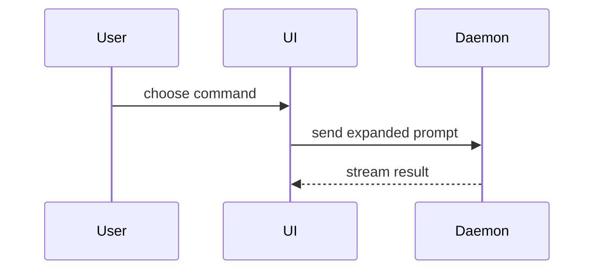

# HTML Communication

## When to Use

Use this skill for any request to produce a readable HTML artifact for a human, whether it is called a plan, spec, write-up, findings, summary, report, comparison, or set of UI mocks presented as readable HTML.

Do not use it for HTML that ships as part of a product.

## Document

Create one self-contained HTML file

- Write it like a spec, not a landing page: dense, scannable, no hero, decorative chrome, marketing voice, or em dashes.
- Vercel Dark Theme, Inter Font, Base font size: 18px (1rem); mọi thứ khác (typography, spacing, container,etc...) scale theo rem
- Make it mobile-readable with a responsive viewport and no fixed-width layout.
- Use semantic HTML, inline CSS, inline SVG, and HTTPS or data-URL images.
- HTML can have classic script only when interactivity materially helps. Keep scripted pages useful without JavaScript; the sandbox blocks storage, fetch, workers, frames, forms, and popups.
- In script-free files, give external links `target="_blank"` and `rel="noopener noreferrer"`. If any script exists, omit `target="_blank"`.

## UI Mocks/Visuals

When the user asks for variants:

- Render real styled variants, not descriptions.
- Label them `A`, `B`, `C`... for easy selection. Each tab per variant
- Keep one file across iterations.
- 

## Rules
- Riêng file này được phép sử dụng hack/trick lỏ (vì không liên quan gì đến production, user dùng để có tầm nhìn bao quát dễ theo dõi task/tiến độ)
- Vietnamese Language Only
- Luôn luôn áp dụng Bro Unslop Ouput Style
- Đặt tên theo format: `{describe}-DD-MM-YYYY` (tự fill ý chính trong {describe})
- Nếu thuộc về project -> nằm riêng trong folder `html-visual` -> copy 2 file trong skill folder `assets/` vào `html-visual`
- Nếu không thuộc về project -> đọc 2 file trong skill folder `assets/` -> nhét thẳng toàn bộ vào 1 file html
- Luôn áp dụng `MASTER HTML SKELETON CHEAT SHEET`
- Default: luôn tạo file mới toanh, không sửa lại file đã tạo trừ khi được yêu cầu
- Tự bật html bằng(non-powershell): `$f=(Resolve-Path "<file>").Path; schtasks /create /sc once /st 23:59 /tn v /tr "cmd /c start msedge --new-window '$f'" /it /f; schtasks /run /i /tn v; Start-Sleep 1; schtasks /delete /tn v /f` + link `file:///`. không cần verify lại là đã bật chưa. cứ chạy là dc
- For a visual UI, layout, state comparison, or concept too dense for Mermaid, write a diagram, an infographic, or a short slide deck, whichever fits the point. Match the product's colors, type, spacing, and components; use real labels and data; support desktop and mobile.

### Design
- Layout & Max-Width: Container 80rem / Base 18px
- Áp dụng Icon/Emoji, màu sắc cho rõ ràng, thú vị, playful, non-boring
- Dùng divider để ngăn cách rõ ràng giữa các phần với nhau (2 cột thường đi chung là 1 phần của nhau)
- Không dùng chữ muted
### Tab Summarize (Default):
- Nếu có nhiều hơn 1 task/variants/lựa chọn/yêu cầu/vấn đề/thông tin/phương án/ý tưởng/câu hỏi/etc... thì hãy tách biệt mỗi thứ là 1 tab (đúng, trong `Tab Summarize` có quyền có nhiều tab dựa theo số lượng dc yêu cầu). Mỗi tab phải có đủ 3 cards
- 1 tab phải có những Card theo thứ tự sau:
1. Card Visual before(trái)/after(phải) dạng Comparison Slider (Swipe Diff) User có thể kéo trượt Drag & Drop qua lại để so sánh trực tiếp. Border màu trắng. content 2 bên phải giữ nguyên 100% width không bị reflow khi kéo slider (clip-path, CROP not RESIZE). Non-Interactive
2. Card Bản `Before` Only, Ưu tiên Interactive nếu có thể. Border Card màu đỏ
3. Card Bản `After` Only, Ưu tiên Interactive nếu có thể. Border Card màu xanh lục
- ONLY ALWAYS Show use case có visual ở cả 3 Cards(Card 1 chỉ là bản copy paste của 2 Cards kia) mà bất kì người thường nào nhìn cũng thấy rõ/hiểu sự khác biệt (không khó hiểu, không technical). Ít text phân tích nhất có thể (Annotation hay Text gốc nằm trong nội dung của Visual thì không tính)
- Trong trường hợp nếu có sẵn ảnh hoặc nếu dùng ảnh làm visual thì sẽ hiệu quả hơn? -> dùng nó
- `🗣️ TÓM LƯỢC & Ý CHÍNH 🗣️` Respond only, đặt trong Callout, center. `max-width`: 40rem
#### Card Visual
- Mỗi Card: `min-height: 30rem`, `padding: 3.5rem 1.5rem 6rem`, `overflow: visible`
- Annotation: Viền nét đứt (dashed) khoanh phần tử + nhãn nổi ở mép viền (Đỏ: lỗi cũ | Xanh: fix mới). Đồng bộ giữa 3 Cards.
- Inspector Toggle:  `[ 🔍 Check Diff ]`:`position: fixed`; `bottom: 1.5rem`; `right: 1.5rem` : ON(default): Hiện Annotation, nhãn nổi. OFF: Ẩn

### Tab Explain:
- Nếu phải explain những thứ không liên quan đến code thì vẫn hãy cứ tuân thủ theo `Zoom-in principle`. vì user muốn có cái nhìn bao quát nhất có thể
- 2 cột ngang nhau được tính là 1 phần và đi kèm lẫn nhau, bên trái phân tích, bên phải show. Có ngăn cách divider giữa các phần rõ ràng.
- Cột trái: Text Explain: 30rem
- Gap giữa 2 cột: 2rem
- Cột phải: Visual Show: 48rem
- `Tab Explain` có thể có nhiều Tabs của riêng nó nếu cần (Tabs mới đó lại có thể có nhiều tầng khác nhau, các tầng bên trong nó lại có thể có nhiều tabs riêng của nó,etc...)

##### Zoom-in principle
- Mỗi Tầng có thể có nhiều Tabs của riêng nó nếu cần
- Trình bày từ tầng cao nhất xuống thấp, 
###### Coding Version
- Cột phải: CẤM dồn 1 dòng & cấm văn xuôi; mỗi bước 1 dòng thụt lề 2-space + icons 📁📄; Vercel dark, syntax highlight, pre-wrap cấm scroll ngang, diff viền trái border-left. 
1. Folder level
2. File & Components level 
3. Function & Call Tree level 
4. Algorithm & Logic level (pseudocode)

####

Help the user understand the current topic of conversation visually. Skip the preamble and keep prose brief. Pick the smallest view that makes the key point clear. Remember to rewrite in html format (NOT markdown)

- Show logic or an algorithm as pseudocode:

```text
on(save)
  if content is unchanged
    return cached result
  write new content
  return fresh result
```

- Show runtime control flow as a call tree:

```text
submitForm
  createSession
    persistPrompt
    launchAgent
  navigateToSession
```

- Show UI structure as a component tree, including state and module boundaries that matter:

```tsx
<SessionPage> (apps/example/src/routes/session.tsx)
  useSessionEvents()
  <SessionToolbar>
    <RunSkillButton> (packages/ui)
```

- Show file responsibility or a broad refactor as a shallow file tree:

```text
src/
├── commands/       # parses user actions
├── sessions/       # owns session state
└── transport/      # sends API requests
```

- Show component interaction, control flow, or data flow with Mermaid:



- Use `diff` when the point is what changes and the surrounding shape already exists. Match the diff shape to the topic.

For a component change:

```diff
 <SessionPage>
   useSessionEvents()
   <SessionToolbar>
+    <RunSkillButton />
   <SessionTimeline>
+    <SkillResultCard />
```

For a file-layout change:

```diff
 src/
 ├── commands/
+│   └── show-me.ts       # expands the slash command
 ├── sessions/
-└── transport.ts
+└── transport/
+    ├── client.ts
+    └── stream.ts
```

For a call-tree or call-stack change:

```diff
 submitForm
   createSession
     persistPrompt
+    expandSkillMention
     launchAgent
-  navigateToSession
+  navigateToSession
+    subscribeToEvents
```

For a state or control-flow change:

```diff
 on(save)
-  write content
+  if content is unchanged
+    return cached result
+  write new content
+  invalidate cache
```

- Show the whole block when most of it is new, when omitted context would hide ownership or order, or when the user needs a copyable target shape:

```ts
function expandSkill(command: string): string {
  const skillName = command.slice(1)
  return `use the ${skillName} skill`
}
```
### guidance

Place each visual next to the short text it supports. Keep only the calls, files, props, states, and boundaries needed to answer the user's current question or the options to resolve the current discussion point.

# MASTER HTML SKELETON CHEAT SHEET (Hãy/Nên thông minh tùy biến/sáng tạo theo input của user, ví dụ: Thêm Card/Tabs/Annotation/Nhãn nổi/Interactive/Tầng/Text/Nội dung/etc... nếu input đơn giản/phức tạp/etc...)

```html
<!DOCTYPE html>
<html lang="vi">
<head>
  <meta charset="UTF-8">
  <meta name="viewport" content="width=device-width, initial-scale=1.0">
  <title>Bản Thiết Kế: TÊN_TASK</title>

  <!-- DUAL-MODE AUTO DETECT:
       - Nếu nằm trong project: dùng link tới ./visual-core.css
       - Nếu standalone ngoài project: nhúng toàn bộ nội dung visual-core.css vào thẻ <style> -->
  <link rel="stylesheet" href="./visual-core.css">

  <style>
    /* ========================================================================
       HỆ THỐNG CSS VARIABLES CỐT LÕI (VERCEL DARK THEME) - DÙNG TRỰC TIẾP
       ========================================================================
       --bg: #000000;         --surface: #0a0a0c;     --card-bg: #121215;
       --border: #2e2e36;     --text-main: #ffffff;   --text-sub: #d4d4d8;
       --accent-red: #ef4444; --accent-green: #22c55e;--accent-blue: #3b82f6;
       --accent-purple: #a855f7;                      --accent-yellow: #eab308;
    */
    /* CSS Mockup đặc thù của task (giữ ngắn gọn, ưu tiên < 80 dòng) */
  </style>
</head>
<body>

  <!-- 1. STICKY TOPBAR (Luôn nổi ở nóc, z-index: 1100) -->
  <header class="nav-header">
    <div class="brand-title"><span>⚡</span> BẢN THIẾT KẾ: TÊN_TASK</div>
    <nav class="tab-group" role="tablist">
      <button class="tab-btn active" role="tab" aria-selected="true" onclick="switchTab('summarize', this)">📌 Tóm Lược</button>
      <button class="tab-btn" role="tab" aria-selected="false" onclick="switchTab('explain', this)">🔍 Giải Thích Chi Tiết</button>
    </nav>
  </header>

  <div class="container">
    <!-- =================================================================
         TAB 1: TÓM LƯỢC (DEFAULT) - CHUẨN 3 CARDS THỊ GIÁC
         ================================================================= -->
    <main id="tab-summarize" class="tab-pane active" role="tabpanel">
      <section class="callout">
        <h2>🗣️ TÓM LƯỢC &amp; Ý CHÍNH 🗣️</h2>
        <p>1 câu ngắn gọn đắt giá nhất truyền tải toàn bộ bức tranh toàn cảnh...</p>
      </section>

      <!-- CARD 1: COMPARISON SLIDER (CSS GRID STACK - NATIVE ANTI-CUTOFF) -->
      <article class="card-wrapper card-slider">
        <div class="card-header-bar">
          <span class="card-badge badge-white">CARD 1: COMPARISON SLIDER</span>
          <span style="font-size: 0.85rem; color: var(--text-main);">Kéo trượt để so sánh Trước / Sau</span>
        </div>
        <div class="slider-viewport">
          <!-- Layer Before (Tự động neo chiều cao chuẩn) -->
          <div class="slider-layer slider-before">
            <div class="diff-highlight" data-diff="annotation" style="position: relative; padding: 1.5rem; background: rgba(239, 68, 68, 0.05); border-radius: 0.5rem;">
              <span class="mock-annotation red">HIỆN TRẠNG CŨ (LỖI)</span>
              <div style="font-weight: 700; color: var(--accent-red); margin-bottom: 0.5rem;">⚠️ Memory Leak trong Handler</div>
              <div style="font-size: 0.88rem; color: var(--text-sub);">Connection pool mở vô hạn khi gặp timeout, không bao giờ tự đóng.</div>
            </div>
          </div>
          <!-- Layer After (Phủ cùng grid-area: 1 / 1, crop bằng clip-path) -->
          <div class="slider-layer slider-after">
            <div class="diff-highlight" data-diff="annotation" style="position: relative; padding: 1.5rem; background: rgba(34, 197, 94, 0.05); border-radius: 0.5rem;">
              <span class="mock-annotation green">GIẢI PHÁP MỚI (FIXED)</span>
              <div style="font-weight: 700; color: var(--accent-green); margin-bottom: 0.5rem;">✅ Auto-Drain Scope Timeout</div>
              <div style="font-size: 0.88rem; color: var(--text-sub);">Tự động giải phóng socket qua AbortSignal và giới hạn max 20 connections.</div>
            </div>
          </div>
          <!-- Divider & Knob bắt cảm ứng chuột/vuốt mượt 60fps & phím điều hướng -->
          <div class="slider-divider">
            <div class="slider-knob" role="slider" aria-label="So sánh Trước và Sau" aria-valuemin="0" aria-valuemax="100" aria-valuenow="50" tabindex="0">⇄</div>
          </div>
          <!-- Range Input ngầm hỗ trợ Accessibility & fallback -->
          <input type="range" class="slider-input-range" min="0" max="100" value="50" tabindex="-1" aria-hidden="true">
        </div>
      </article>

      <!-- CARD 2: BEFORE ONLY (Hiện trạng lỗi/nhược điểm) -->
      <article class="card-wrapper card-before">
        <div class="card-header-bar">
          <span class="card-badge badge-red">CARD 2: BEFORE ONLY</span>
          <span style="font-size: 0.85rem; color: var(--accent-red);">Mô tả nhược điểm cũ</span>
        </div>
        <div class="diff-highlight" data-diff="annotation" style="position: relative; padding: 1.5rem; border-radius: 0.5rem; background: rgba(239, 68, 68, 0.04);">
          <span class="mock-annotation red">BLOCKER</span>
          <div style="display: flex; align-items: center; gap: 0.5rem; margin-bottom: 0.5rem;">
            <span class="diff-tag del">- CŨ</span>
            <span style="font-size: 0.95rem; font-weight: 700; color: var(--accent-red);">Thiếu cơ chế Timeout &amp; Drain</span>
          </div>
          <p style="font-size: 0.88rem; color: var(--text-sub); line-height: 1.5;">Khi backend downstream quá tải, hàng nghìn connection bị treo ngầm khiến bộ nhớ tăng phi mã đến khi OOM crash.</p>
        </div>
      </article>

      <!-- CARD 3: AFTER ONLY (Giải pháp mới hoàn thiện + Nút tương tác thật với showToast) -->
      <article class="card-wrapper card-after">
        <div class="card-header-bar">
          <span class="card-badge badge-green">CARD 3: AFTER ONLY</span>
          <span style="font-size: 0.85rem; color: var(--accent-green);">Có nút bấm tương tác thật</span>
        </div>
        <div class="diff-highlight" data-diff="annotation" style="position: relative; padding: 1.5rem; border-radius: 0.5rem; background: rgba(34, 197, 94, 0.04);">
          <span class="mock-annotation green">ĐÃ TỐI ƯU</span>
          <div style="display: flex; align-items: center; gap: 0.5rem; margin-bottom: 0.5rem;">
            <span class="diff-tag add">+ MỚI</span>
            <span style="font-size: 0.95rem; font-weight: 700; color: var(--accent-green);">Tự động tái chế Connection với AbortController</span>
          </div>
          <p style="font-size: 0.88rem; color: var(--text-sub); line-height: 1.5; margin-bottom: 1rem;">Mỗi request được bọc trong vòng đời ngắn, timeout tự kích hoạt hủy kết nối và tái sử dụng slot trống.</p>
          <div style="display: flex; gap: 0.75rem; flex-wrap: wrap;">
            <button type="button" class="tab-btn active" style="background: var(--accent-green); color: #000000; font-weight: 700;" onclick="showToast('✅ Thao tác thành công: Đã kích hoạt test connection drain!', 'success')">
              ⚡ Bấm thử tương tác (Success Toast)
            </button>
            <button type="button" class="tab-btn" style="border: 1px solid var(--border);" onclick="showToast('ℹ️ Trạng thái: Bộ đệm socket đang ổn định.', 'info')">
              ℹ️ Kiểm tra trạng thái (Info Toast)
            </button>
          </div>
        </div>
      </article>
    </main>

    <!-- =================================================================
         TAB 2: GIẢI THÍCH CHI TIẾT (4 TẦNG ZOOM-IN 2 CỘT & HỖ TRỢ NESTED TABS)
         ================================================================= -->
    <section id="tab-explain" class="tab-pane" role="tabpanel" style="display: none;">
      <!-- Lặp lại explain-section cho từng tầng: VĨ MÔ -> UI -> RUNTIME -> LOGIC -->

      <!-- TẦNG 1: VĨ MÔ & CẤU TRÚC THƯ MỤC -->
      <section class="explain-section">
        <div class="explain-layout">
          <!-- Cột Trái (minmax 20rem-30rem sticky) -->
          <div class="explain-text-col">
            <div class="zoom-tier-badge">TẦNG 1/4 • VĨ MÔ</div>
            <h3>📁 1. Cấu Trúc Thư Mục</h3>
            <p>Mô tả súc tích bản chất thay đổi kiến trúc và ranh giới module...</p>
            <div class="meta-tag-group">
              <span class="meta-tag green">Mới</span>
              <span class="meta-tag blue">Module</span>
            </div>
          </div>

          <!-- Cột Phải (code container với đầy đủ tokens & IDE dropdown) -->
          <div class="code-container">
            <div class="code-topbar">
              <div class="code-topbar-left">
                <div class="code-dots">
                  <span class="code-dot red"></span><span class="code-dot yellow"></span><span class="code-dot green"></span>
                </div>
                <!-- Dropdown File Path & IDE launcher -->
                <div class="file-dropdown-wrapper">
                  <button class="file-dropdown-trigger" type="button" aria-haspopup="menu" aria-expanded="false" onclick="toggleFileDropdown(this)">
                    <span>📁 src/pool/</span><span class="chevron">▼</span>
                  </button>
                  <div class="file-dropdown-menu">
                    <div class="file-dropdown-header"><span>TẬP TIN</span><span>DIR</span></div>
                    <a class="file-dropdown-item ide" href="vscode://file/C:/path/to/file">Mở trong VS Code</a>
                    <button class="file-dropdown-item path" type="button" onclick="copyFilePath('src/pool/manager.ts')">Sao chép đường dẫn</button>
                  </div>
                </div>
              </div>
              <div class="code-actions">
                <span class="diff-stat"><span class="stat-add">+15</span> <span class="stat-del">-4</span></span>
                <!-- Preset ngôn ngữ: structure | ts | tsx | js | jsx | html | css | rust | go | py | flow | logic -->
                <span class="code-lang-badge"><span class="lang-dot structure"></span> STRUCTURE</span>
                <button class="btn-copy-code" type="button" onclick="copyCodeBlock(this)">Sao chép</button>
              </div>
            </div>

            <!-- Khối Code Từng Dòng + Syntax Highlight (Đủ 9 token: kwd, fn, tag, attr, prop, str, num, punc, tg) -->
            <div class="code-body">
              <div class="c-line"><span class="c-sign"></span><span class="c-text"><span class="tg">├── </span>📁 <span class="prop">src</span>/</span></div>
              <div class="c-line add"><span class="c-sign">+</span><span class="c-text">  <span class="kwd">const</span> <span class="prop">maxSockets</span>: <span class="kwd">number</span> = <span class="num">20</span>;</span><span class="c-comment"># .num, .kwd</span></div>
              <div class="c-line add"><span class="c-sign">+</span><span class="c-text">  <span class="kwd">const</span> <span class="prop">endpoint</span> = <span class="str">"https://api.db/v1"</span>;</span><span class="c-comment"># .str</span></div>
              <div class="c-line add"><span class="c-sign">+</span><span class="c-text">  <span class="kwd">const</span> <span class="prop">btn</span> = <span class="punc">&lt;</span><span class="tag">Button</span> <span class="attr">variant</span>=<span class="str">"primary"</span><span class="punc">&gt;</span>;</span><span class="c-comment"># .tag, .attr, .punc</span></div>
              <div class="c-line add"><span class="c-sign">+</span><span class="c-text">  <span class="kwd">const</span> <span class="prop">session</span> = <span class="fn">createSession</span>();</span><span class="c-comment"># .prop, .fn</span></div>
              <div class="c-line del"><span class="c-sign">-</span><span class="c-text">  <span class="fn">oldUnboundedHandler</span>();</span><span class="c-comment"># tự lọc bỏ khi copy!</span></div>
            </div>
          </div>
        </div>
      </section>

      <!-- VÍ DỤ TẦNG CÓ NESTED SUB-TABS (KHI NỘI DUNG/KỊCH BẢN QUÁ PHỨC TẠP CẦN CHIA NHÁNH) -->
      <section class="explain-section">
        <div class="explain-layout">
          <div class="explain-text-col">
            <div class="zoom-tier-badge">TẦNG 2/4 • ĐA KỊCH BẢN (NESTED TABS)</div>
            <h3>🔀 2. Kịch Bản &amp; Phương Án</h3>
            <p>Hệ thống tự động hỗ trợ tab lồng nhau. Bấm chọn nhánh bên dưới mà không làm ảnh hưởng tới tab cha:</p>
            <!-- Sub-tabs Group (dùng class sub-tabs) -->
            <nav class="tab-group sub-tabs" role="tablist">
              <button class="tab-btn active" role="tab" aria-selected="true" onclick="switchTab('sub-flow-sync', this)">⚡ Luồng Sync</button>
              <button class="tab-btn" role="tab" aria-selected="false" onclick="switchTab('sub-flow-async', this)">🔄 Luồng Async Worker</button>
            </nav>
            <div class="meta-tag-group">
              <span class="meta-tag yellow">Rẽ nhánh</span>
              <span class="meta-tag blue">Độc lập</span>
            </div>
          </div>

          <!-- Khối Sub-Panes lồng nhau -->
          <div style="min-width: 0; width: 100%;">
            <!-- Sub-Pane 1: Luồng Sync -->
            <div id="tab-sub-flow-sync" class="tab-pane active" data-tab-pane="sub-flow-sync" role="tabpanel">
              <div class="code-container">
                <div class="code-topbar">
                  <div class="code-topbar-left">
                    <span class="code-dot green"></span>
                    <span style="font-size: 0.78rem; font-weight: 700; color: #e4e4e7;">📄 sync-pipeline.ts</span>
                  </div>
                  <div class="code-actions">
                    <span class="code-lang-badge"><span class="lang-dot ts"></span> TS</span>
                    <button class="btn-copy-code" type="button" onclick="copyCodeBlock(this)">Sao chép</button>
                  </div>
                </div>
                <div class="code-body">
                  <div class="c-line"><span class="c-sign"></span><span class="c-text"><span class="kwd">export function</span> <span class="fn">handleDirect</span>(<span class="prop">req</span>) {</span></div>
                  <div class="c-line add"><span class="c-sign">+</span><span class="c-text">  <span class="kwd">return</span> <span class="fn">executeWithinTimeout</span>(<span class="prop">req</span>, <span class="num">3000</span>);</span><span class="c-comment"># timeout trực tiếp</span></div>
                  <div class="c-line"><span class="c-sign"></span><span class="c-text">}</span></div>
                </div>
              </div>
            </div>

            <!-- Sub-Pane 2: Luồng Async Worker -->
            <div id="tab-sub-flow-async" class="tab-pane" data-tab-pane="sub-flow-async" role="tabpanel" style="display: none;">
              <div class="code-container">
                <div class="code-topbar">
                  <div class="code-topbar-left">
                    <span class="code-dot yellow"></span>
                    <span style="font-size: 0.78rem; font-weight: 700; color: #e4e4e7;">📄 worker-queue.ts</span>
                  </div>
                  <div class="code-actions">
                    <span class="code-lang-badge"><span class="lang-dot ts"></span> TS</span>
                    <button class="btn-copy-code" type="button" onclick="copyCodeBlock(this)">Sao chép</button>
                  </div>
                </div>
                <div class="code-body">
                  <div class="c-line"><span class="c-sign"></span><span class="c-text"><span class="kwd">export async function</span> <span class="fn">enqueueJob</span>(<span class="prop">payload</span>) {</span></div>
                  <div class="c-line add"><span class="c-sign">+</span><span class="c-text">  <span class="kwd">await</span> <span class="prop">queue</span>.<span class="fn">push</span>(<span class="prop">payload</span>);</span><span class="c-comment"># đẩy vào hàng đợi worker</span></div>
                  <div class="c-line"><span class="c-sign"></span><span class="c-text">}</span></div>
                </div>
              </div>
            </div>
          </div>
        </div>
      </section>
    </section>
  </div>

  <!-- Nút Inspector Toggle Fixed (Chỉ hiện khi active tab có chứa selector diff, tự ẩn khi sang tab explain thuần) -->
  <button id="inspector-toggle" onclick="toggleDiff()">
    <span>🔍 Check Diff</span>
    <span id="diffStatusTag">[BẬT]</span>
  </button>

  <!-- DUAL-MODE AUTO DETECT:
       - Nếu nằm trong project: dùng script src="./visual-core.js"
       - Nếu standalone ngoài project: nhúng toàn bộ nội dung visual-core.js vào thẻ <script> -->
  <script src="./visual-core.js"></script>
</body>
</html>
```

### CHEAT SHEET TIỆN ÍCH CỐT LÕI (DÀNH RIÊNG CHO AI SINH CODE):

| Nhóm Tính Năng | Cú Pháp / Class / Hàm | Mô Tả & Lưu Ý Của AI |
| :--- | :--- | :--- |
| **Toast Feedback** | `showToast('Nội dung', 'success' \| 'error' \| 'info', 2000)` | Dùng khi làm nút tương tác trong Card 3 hoặc bất kỳ demo nào. |
| **Chuyển Tab Phẳng & Lồng Nhau** | `switchTab('tên_tab', this)` | Hỗ trợ cả tab cấp cao lẫn cụm sub-tabs bên trong mà không làm mất trạng thái của nhau. |
| **Inspector Toggle** | `#inspector-toggle` & `toggleDiff()` | Chỉ tự động hiển thị nếu tab hiện tại có chứa ít nhất 1 element thuộc: `.slider-viewport`, `.diff-tag`, `.diff-highlight`, `.mock-annotation`, `[data-diff="annotation"]`. |
| **Annotation Nổi** | `<span class="mock-annotation [green\|red\|blue\|purple]">` | Đặt bên trong container `position: relative` để ghim nhãn nổi ở mép viền. |
| **Diff Highlight** | `<div class="diff-highlight" data-diff="annotation">` | Tạo viền nét đứt (dashed) khoanh vùng thay đổi; tự động biến mất khi tắt diff. |
| **Diff Tag** | `<span class="diff-tag [add\|del]">` | Badge nhỏ màu xanh lá (`+`) hoặc đỏ (`-`) biểu thị trạng thái thêm/bớt. |
| **Syntax Highlighting** | `.kwd`, `.fn`, `.tag`, `.attr`, `.prop`, `.str`, `.num`, `.punc`, `.tg` | Dùng chuẩn các class này để bọc chữ trong `.c-text` của từng dòng `.c-line`. |
| **Tự Lọc Dòng Đã Xóa** | `<div class="c-line del">` | Nút "Sao chép" (`copyCodeBlock`) sẽ tự động bỏ qua toàn bộ dòng `.del` để chỉ copy code sạch. |
| **CSS Variables** | `var(--surface)`, `var(--card-bg)`, `var(--border)`, `var(--text-main)`, `var(--accent-*)` | Luôn dùng biến thay vì viết mã màu hex thô. |
